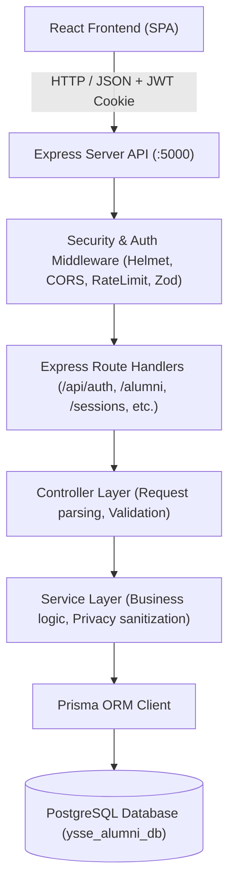

# YSSE Alumni Directory — System Architecture & File Reference Guide

## 1. System Overview & Technology Stack

The **YSSE Alumni Directory** is a centralized platform developed for the Youth School for Social Entrepreneurs (YSSE) community. It enables alumni, current members, and administrators to connect, explore professional journeys, exchange knowledge via **Alumni Talk** sessions, and book 1:1 mentorship sessions.

### Core Stack
- **Frontend**: React 18, TypeScript, Tailwind CSS, Vite, Lucide Icons, `@tanstack/react-query`
- **Backend API**: Node.js, Express, TypeScript, Zod Schema Validation, Pino Logger
- **Database & ORM**: PostgreSQL, Prisma ORM
- **Authentication**: JWT (JSON Web Tokens) with HTTP-only cookies, crypto-scrypt password hashing with constant-time verification, Google OAuth 2.0 SDK
- **Security & Hardening**: Helmet (CSP/CORP headers), CORS origin whitelisting, Express Rate Limiters, Public Profile Data Sanitization (Privacy Shield)

---

## 2. End-to-End System Architecture & Data Flow



### 2.1 Authentication & RBAC Flow
1. **Registration / Login**: User submits email + password or Google ID token to `/api/auth/login` or `/api/auth/google`.
2. **Password Verification**: Handled by `password.ts` using Node.js native `crypto.scryptSync` with unique 16-byte cryptographically secure salts and `crypto.timingSafeEqual` comparison against timing attacks.
3. **Session Issuance**: A signed JWT containing user ID, role, and email is returned and set inside an `httpOnly`, `sameSite: 'lax'` cookie.
4. **Role Enforcement**:
   - `authenticate`: Validates JWT signature and verifies user exists in DB.
   - `requireAdmin`: Validates `req.user.role === 'ADMIN'`. Blocks unauthorized access with `403 FORBIDDEN`.
   - `optionalAuth`: Silently extracts user context for public endpoints to decide whether sensitive contact fields (email, LinkedIn) can be revealed.

### 2.2 Alumni Profile & Privacy Lifecycle
1. **Public Exploration**: Any visitor can browse alumni by name, wing, batch, or organization.
2. **Privacy Sanitization (`mapProfileToView`)**:
   - **Anonymous Visitor**: Email and LinkedIn are stripped out (`undefined`).
   - **Authenticated Member**: Can see contact info only if `isContactPublic: true`.
   - **Profile Owner / Admin**: Has full access to own contact details, audit timestamps, and approval status.
3. **Profile Creation & Approval**:
   - New alumni register and submit their profile with their YSSE wing, batch, and current organization.
   - Profile enters `PENDING` status.
   - Admin reviews submission via `/admin/approvals`. If approved, status becomes `APPROVED` and displays on the public directory. If rejected, a required rejection reason is recorded.
   - Alumni can publish their personal **Alumni Story** to inspire others.

### 2.3 Alumni Talk (Knowledge Sharing)
- Alumni or administrators can publish video recordings and session details of community talks.
- Listed publicly on `/alumni-talk` with filtering by wing and topic, direct playback links, speaker information, and event date.

### 2.4 Mentorship & 1:1 Sessions Lifecycle
- Alumni enable `openToSessions` and configure their mentorship topics and availability notes.
- Registered members submit session requests with purpose and proposed dates.
- Alumni review, approve, or decline incoming requests directly from their profile/sessions portal.

---

## 3. Directory Structure & File-by-File Guide

### 3.1 Backend: `server/`

```
server/
├── prisma/
│   ├── schema.prisma         # Prisma schema defining User, AlumniProfile, Wing, Session, Talk
│   ├── seed.ts               # Seeds official 5 YSSE wings and default Admin user
│   └── migrations/           # Versioned SQL migration files
├── src/
│   ├── server.ts             # Server entry point; binds HTTP port and handles process shutdown
│   ├── app.ts                # Express application bootstrap: Helmet, CORS, cookies, routing
│   ├── config/
│   │   └── env.ts            # Validated environment variables schema via Zod
│   ├── lib/
│   │   ├── apiResponse.ts    # Standardized JSON response envelope (ok, fail)
│   │   ├── AppError.ts       # Typed operational error classes with HTTP status codes
│   │   ├── googleClient.ts   # Google OAuth2 client initialization
│   │   ├── jwt.ts            # JWT signing, verification, and cookie extraction
│   │   ├── logger.ts         # Pino structured logging
│   │   ├── pagination.ts     # Standard pagination helper (skip, take, metadata)
│   │   ├── password.ts       # Scrypt hashing and constant-time password verification
│   │   ├── prisma.ts         # Singleton PrismaClient instance
│   │   └── publicProfile.ts  # Privacy-aware alumni profile field sanitization
│   ├── middleware/
│   │   ├── authenticate.ts   # Guard requiring valid JWT authentication
│   │   ├── optionalAuth.ts   # Non-blocking auth extractor for public endpoints
│   │   ├── requireAdmin.ts   # Guard verifying ADMIN role
│   │   ├── errorHandler.ts   # Centralized error handler; sanitizes production errors
│   │   ├── notFound.ts       # Standardized 404 handler
│   │   ├── rateLimiters.ts   # Express rate limiters for auth and public listing
│   │   ├── upload.ts         # Multer image upload middleware (JPEG/PNG/WebP, 2MB max)
│   │   └── validate.ts       # Zod schema request body / query validator
│   ├── modules/
│   │   ├── auth/             # Login, Register, Google OAuth, Profile retrieval
│   │   ├── alumni/           # Alumni directory CRUD, filtering, photo upload, stories
│   │   ├── admin/            # Admin stats, profile approvals, CSV import, user management
│   │   ├── sessions/         # 1:1 Mentorship offer and booking lifecycle
│   │   ├── talks/            # Alumni Talk knowledge sharing sessions & recordings
│   │   └── wings/            # Official YSSE Wings listing and management
│   └── types/
│       └── express.d.ts      # Global Express Request & UserPayload type augmentation
├── tests/                    # Vitest integration & unit test suite
├── package.json              # Backend dependencies and run scripts
└── tsconfig.json             # TypeScript compiler configuration
```

### 3.2 Frontend: `src/`

```
src/
├── main.tsx                  # Application bootstrap rendering Root and QueryClient
├── App.tsx                   # Main router configuration, ProtectedRoute, role guards
├── index.css                 # Global CSS variables, theme design tokens, utility classes
├── api/
│   ├── client.ts             # Axios/fetch HTTP client with credentials and interceptors
│   ├── alumniApi.ts          # API calls for directory, alumni profiles, stories
│   ├── sessionApi.ts         # API calls for 1:1 mentorship booking and offers
│   └── dashboardApi.ts       # API calls for admin metrics and reporting
├── context/
│   ├── AuthContext.tsx       # Global authentication state, login, logout, current user
│   └── ToastContext.tsx      # System toast notification provider
├── hooks/
│   ├── useCan.ts             # Role-based capability permission hook (canEdit, canManage)
│   ├── useAlumniAdmin.ts     # React Query hook for admin alumni operations
│   ├── useApprovals.ts       # React Query hook for pending approval queues
│   ├── useAdminSessions.ts   # React Query hook for admin session overviews
│   ├── useDashboard.ts       # React Query hook for metrics and activity streams
│   └── useCsvImport.ts       # Hook for parsing, previewing, and importing alumni CSV
├── services/
│   ├── authService.ts        # Authentication HTTP calls (login, register, logout, me)
│   ├── alumniService.ts      # Directory search, profile details, photo upload
│   ├── alumniMapper.ts       # Frontend DTO adapter for alumni profile records
│   ├── sessionService.ts     # Session booking, acceptance, and cancellation
│   ├── sessionMapper.ts      # Frontend DTO adapter for session records
│   ├── talkService.ts        # Alumni Talk retrieval and creation
│   └── adminService.ts       # Admin actions: approve, reject, CSV batch import
├── components/
│   ├── admin/                # Admin table components, CSV dropzone, approval cards
│   ├── charts/               # Analytics visualization widgets (recharts)
│   ├── common/               # Universal UI primitives (Button, Modal, Input, Badge)
│   ├── landing/              # Hero, stats counters, wing highlights, testimonials
│   ├── layout/               # Navbar, Footer, Mobile Navigation, Sidebar
│   ├── profile/              # Alumni profile header, story card, request session modal
│   ├── shared/               # SearchBar, FilterBar, EmptyState, SkeletonLoader
│   └── talks/                # TalkCard, TalksRecordingsList, AddTalkModal
├── pages/
│   ├── LandingPage.tsx       # Public homepage welcoming visitors with highlights
│   ├── DirectoryPage.tsx     # Searchable, filterable alumni catalog with badges
│   ├── AlumniProfilePage.tsx # Detailed single alumni profile view with story & sessions
│   ├── MyProfilePage.tsx     # Alumni self-management dashboard (edit bio, story, sessions)
│   ├── SessionsPage.tsx      # Alumni Talk portal & 1:1 mentorship booking overview
│   ├── AccountPage.tsx       # User account settings, password update, privacy toggles
│   └── admin/                # Admin sub-pages (Dashboard, Alumni, Approvals, Import, etc.)
└── types/
    ├── index.ts              # Core shared data types (User, Alumni, Session, Talk)
    └── admin.ts              # Admin DTOs, metrics, and batch import schemas
```

---

## 4. Security & Quality Audit Checklist

| Security Dimension | Implementation Detail | Status |
| :--- | :--- | :---: |
| **Password Security** | `crypto.scryptSync` with 16-byte random salt + `crypto.timingSafeEqual` comparison | ✅ Passed |
| **Session & Token** | JWT with expiration, passed in `httpOnly` secure cookie + Bearer header fallback | ✅ Passed |
| **Role-Based Guards** | Explicit `requireAdmin` middleware on all administrative routes | ✅ Passed |
| **Contact Privacy** | Sanitized in `publicProfile.ts`; hidden from public; only visible per user preference | ✅ Passed |
| **SQL Injection** | 100% Parameterized queries through Prisma ORM (zero string concatenation) | ✅ Passed |
| **XSS Prevention** | React virtual DOM auto-escaping + Helmet CSP and frame protection headers | ✅ Passed |
| **CORS Policy** | Whitelisted origin check; credentials enabled; blocked unauthorized domains | ✅ Passed |
| **Rate Limiting** | Strict limiters on `/api/auth` (10 req/15min) and public search listings | ✅ Passed |
| **Input Validation** | 100% Zod validation for body, query params, and route parameters | ✅ Passed |
| **Zero Mock Data** | All mock databases removed; dynamic data from PostgreSQL | ✅ Passed |
| **Code Modularity** | All backend modules $\le 150$ lines, cleanly partitioned | ✅ Passed |
| **Automated Testing** | 18 passing Vitest tests covering auth, admin guards, privacy, talks, and CSV | ✅ Passed |

---

## 5. Operations & Developer Runbook

### Starting the Local Development Environment
```bash
# Terminal 1: Start Backend (Port 5000)
cd server
npm run dev

# Terminal 2: Start Frontend (Port 5173)
cd ..
npm run dev
```

### Database Synchronization & Seeding
```bash
cd server
npx prisma migrate dev      # Applies all pending migrations
npm run prisma:seed         # Syncs official wings & administrator account
```

### Running Automated Tests
```bash
cd server
npm test                    # Executes all 18 Vitest unit & integration tests
```

### Building for Production
```bash
# Frontend Build
npm run build               # Runs TypeScript project build (tsc -b) & Vite bundling

# Backend Build
cd server
npm run build               # Compiles TypeScript to dist/
```
